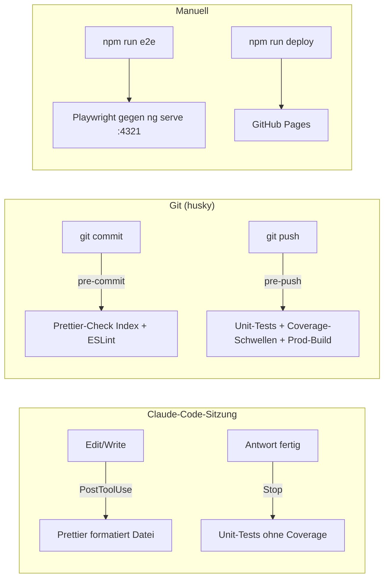

# CI/CD-Pipelines – hq-master

Stand: 2026-10-18

## 1. Übersicht

hq-master hat **keine serverseitige CI** (kein `.github/workflows/`). Die Qualitätssicherung
läuft vollständig **lokal** in drei Stufen, die automatisch an Git- bzw. Claude-Code-Ereignisse
gekoppelt sind. Das Deployment auf GitHub Pages wird manuell angestoßen.



| Stufe              | Auslöser                       | Prüfungen                                         | Ziel-Dauer  | Blockiert   |
| ------------------ | ------------------------------ | ------------------------------------------------- | ----------- | ----------- |
| Claude PostToolUse | jede Datei-Änderung von Claude | Prettier-Formatierung (schreibt)                  | < 1 s       | nie         |
| Claude Stop        | Ende jeder Claude-Antwort      | `npm run test` (nur bei Änderungen in `src/`)     | ≤ 240 s     | Claude (1×) |
| pre-commit         | `git commit`                   | Prettier-Check (gestagter Inhalt), `npm run lint` | < ~15 s     | Commit      |
| pre-push           | `git push`                     | Tests + Coverage-Schwellen, `npm run build`       | ≤ 2 × 600 s | Push        |
| E2E                | manuell `npm run e2e`          | Playwright-Smoke-Tests                            | –           | –           |
| Deploy             | manuell `npm run deploy`       | Build + Veröffentlichung auf `gh-pages`           | –           | –           |

### Eingesetzte Tools

| Tool                             | Version (package.json) | Aufgabe                                                      |
| -------------------------------- | ---------------------- | ------------------------------------------------------------ |
| **npm**                          | 11.9.0                 | Script-Einstiegspunkte, `prepare` aktiviert husky            |
| **husky**                        | ^9.1.7                 | Verdrahtet Git-Hooks mit den Node-Skripten                   |
| **Node.js-Hook-Skripte**         | –                      | Eigentliche Hook-Logik (`scripts/git-hooks/*.mjs`)           |
| **Prettier**                     | ^3.8.1                 | Formatierung (Check im Commit, Auto-Format bei Claude)       |
| **ESLint** + angular-eslint      | ^10.3.0 / 21.4.0       | Lint für `src/**/*.ts` und `src/**/*.html`                   |
| **Angular CLI / @angular/build** | ^21.2.20               | Build, Dev-Server, Unit-Test-, Lint- und Deploy-Builder      |
| **Vitest** + jsdom + coverage-v8 | ^4.0.8 / ^28 / ^4.1.10 | Unit-Tests und Coverage                                      |
| **Playwright**                   | ^1.64.1                | E2E-Smoke-Tests (Chromium)                                   |
| **angular-cli-ghpages**          | ^3.1.0                 | Deployment auf GitHub Pages                                  |
| **Claude Code Hooks**            | –                      | Formatierung, Test-Gate, Aktivitätslog während der KI-Arbeit |

### Verzeichnisstruktur der Konfigurationen

```text
hq-master/
├── package.json               # npm-Scripts (test, lint, build, e2e, deploy, prepare)
├── angular.json               # Builder-Targets: build, serve, test, lint, deploy
├── vitest.config.ts           # Coverage-Schwellen (runnerConfig des Test-Builders)
├── playwright.config.ts       # E2E-Konfiguration inkl. webServer (Port 4321)
├── eslint.config.js           # ESLint Flat Config (TS + Angular-Templates)
├── .prettierrc                # Prettier-Regeln
├── .editorconfig              # Editor-Grundregeln (UTF-8, 2 Spaces, finale Leerzeile)
├── .gitattributes             # erzwingt LF-Zeilenenden im Repository
├── tsconfig.spec.json         # TypeScript für Specs (vitest/globals)
├── .husky/
│   ├── pre-commit             # → node scripts/git-hooks/pre-commit.mjs
│   ├── pre-push               # → node scripts/git-hooks/pre-push.mjs
│   └── _/                     # von husky generiert (core.hooksPath), nicht bearbeiten
├── scripts/git-hooks/
│   ├── pre-commit.mjs         # Prettier-Check + Lint
│   ├── pre-push.mjs           # Tests + Coverage + Build
│   └── run-with-timeout.mjs   # gemeinsames Modul: Timeout + Prozessbaum-Kill
├── .claude/
│   ├── settings.json          # Registrierung der Claude-Hooks + Berechtigungen
│   ├── hooks/
│   │   ├── format-file.mjs    # PostToolUse: Prettier
│   │   ├── stop-run-tests.mjs # Stop: Unit-Tests
│   │   └── log-activity.mjs   # Aktivitätslog
│   └── logs/activity.log      # (gitignored)
├── src/
│   ├── test-setup.ts          # globales Vitest-Setup (localStorage leeren)
│   └── environments/          # environment.ts / environment.prod.ts (fileReplacement)
├── e2e/                       # Playwright-Specs + eigene tsconfig.json
├── coverage/                  # Coverage-Report (gitignored)
├── test-results/              # Playwright-Artefakte (gitignored)
└── dist/                      # Build-Ausgabe (gitignored)
```

---

## 2. npm-Scripts (Einstiegspunkte)

Alle Pipeline-Schritte laufen über `package.json`-Scripts, die auf Angular-CLI-Targets bzw.
Playwright zeigen:

| Script           | Befehl                                                        | Verwendet von                               |
| ---------------- | ------------------------------------------------------------- | ------------------------------------------- |
| `npm start`      | `ng serve` (Konfiguration `development`, Port 4200)           | Entwickler                                  |
| `npm run build`  | `ng build` (Default-Konfiguration `production`)               | pre-push, Deploy                            |
| `npm run watch`  | `ng build --watch --configuration development`                | Entwickler                                  |
| `npm run test`   | `ng test` (Vitest über `@angular/build:unit-test`)            | pre-push, Stop-Hook                         |
| `npm run lint`   | `ng lint` (`@angular-eslint/builder:lint`)                    | pre-commit                                  |
| `npm run e2e`    | `playwright test --project=chromium` (nur Smoke-Suite)        | manuell, Skills implement-feature/-refactor |
| `npm run deploy` | `ng deploy --base-href="https://mrmame.github.io/hq-master/"` | manuell                                     |
| `prepare`        | `husky`                                                       | automatisch bei `npm install`               |

Gezielt eine Spec ausführen (schnellster Lauf):

```bash
npm run test -- --watch=false --include src/app/<pfad>/<datei>.spec.ts
```

---

## 3. husky (Git-Hook-Verdrahtung)

**Konfiguration:** `.husky/pre-commit`, `.husky/pre-push`, generierter Ordner `.husky/_/`

- `npm install` führt das `prepare`-Script aus → `husky` setzt `git config core.hooksPath .husky/_`.
- In `.husky/_/` liegt für jeden Git-Hook ein Stub, der das gemeinsame Skript `.husky/_/h`
  lädt. Dieses sucht die gleichnamige Datei in `.husky/` (z. B. `.husky/pre-push`) und führt sie
  mit `sh -e` aus. Existiert keine, passiert nichts.
- `h` ergänzt `node_modules/.bin` im `PATH` und meldet fehlgeschlagene Hooks
  (`husky - pre-push script failed (code 1)`).
- Die eigentlichen Hook-Dateien enthalten bewusst nur eine Zeile (`node scripts/git-hooks/….mjs`);
  die Logik liegt in Node, damit sie unter Windows (Git Bash) und Unix gleich funktioniert.

**Umgehung / Steuerung:**

| Mittel                   | Wirkung                                                          |
| ------------------------ | ---------------------------------------------------------------- |
| `git commit --no-verify` | überspringt pre-commit (nur begründet, Begründung in Commit-Msg) |
| `git push --no-verify`   | überspringt pre-push                                             |
| `HUSKY=0`                | deaktiviert alle husky-Hooks für den Aufruf                      |
| `HUSKY=2`                | Debug-Ausgabe (`set -x`)                                         |

---

## 4. pre-commit-Hook

**Datei:** `scripts/git-hooks/pre-commit.mjs` · **Ziel:** < ~15 s

Ablauf:

1. Liste der gestagten Dateien: `git diff --cached --name-only --diff-filter=ACMR`
   (hinzugefügt, kopiert, geändert, umbenannt – gelöschte Dateien werden ignoriert).
2. Für jede Datei, die Prettier kennt und die nicht ignoriert ist: Inhalt **aus dem Index**
   (`git show :<datei>`) gegen die Prettier-Konfiguration prüfen.
   Grund: Die Working Copy kann wegen `core.autocrlf` CRLF enthalten und würde sonst Fehlalarme
   auslösen.
3. Unformatierte Dateien → Commit blockiert, Liste der Dateien wird ausgegeben.
4. `npm run lint` ausführen → bei Fehlern Commit blockiert, Lint-Ausgabe wird angezeigt.

Build und Tests laufen hier bewusst **nicht**, damit Commits schnell bleiben.

**Fehler beheben:** `npx prettier --write <datei>` bzw. Lint-Meldung korrigieren, erneut stagen.

---

## 5. pre-push-Hook

**Datei:** `scripts/git-hooks/pre-push.mjs` · **Timeout:** 600 s je Schritt

Führt nacheinander aus (Abbruch beim ersten Fehler):

| Schritt               | Befehl                                     |
| --------------------- | ------------------------------------------ |
| Unit-Tests + Coverage | `npm run test -- --watch=false --coverage` |
| Production-Build      | `npm run build`                            |

- Schlägt ein Schritt fehl oder werden die Coverage-Schwellen (Kapitel 9) unterschritten,
  wird der Push abgebrochen; die letzten 80 Zeilen der Ausgabe werden angezeigt.
- Bei Timeout wird der gesamte Prozessbaum beendet (Kapitel 6) und die letzten 30 Zeilen gezeigt.
- Timeout per Umgebungsvariable anpassbar: `HQ_PRE_PUSH_TIMEOUT_S=900 git push`.

---

## 6. Gemeinsames Modul `run-with-timeout.mjs`

**Datei:** `scripts/git-hooks/run-with-timeout.mjs` – genutzt von `pre-push.mjs` und
`.claude/hooks/stop-run-tests.mjs`

| Export       | Aufgabe                                                                                 |
| ------------ | --------------------------------------------------------------------------------------- |
| `runCommand` | startet einen Shell-Befehl, sammelt die letzten 16 000 Zeichen Ausgabe, eigenes Timeout |
| `lastLines`  | kürzt Ausgabe auf die letzten _n_ Zeilen                                                |
| `projectCwd` | normalisiert den Laufwerksbuchstaben auf Großbuchstaben                                 |

Hintergründe:

- **Prozessbaum-Kill:** Bei Timeout wird nicht nur `npm`, sondern die ganze Kette
  `npm → ng test → vitest` beendet (Windows: `taskkill /T /F`, Unix: Kill der Prozessgruppe).
  Sonst bleiben z. B. bei einer synchronen Endlosschleife in einem Test verwaiste node-Prozesse
  zurück.
- **Laufwerksbuchstabe:** Vitest findet unter Windows seinen Runner nicht, wenn das
  Arbeitsverzeichnis mit kleinem Laufwerksbuchstaben (`f:\…`) beginnt. `projectCwd()` macht
  daraus `F:\…`.

---

## 7. Prettier (Formatierung)

**Konfiguration:** `.prettierrc`

```json
{
  "printWidth": 100,
  "singleQuote": true,
  "overrides": [{ "files": "*.html", "options": { "parser": "angular" } }]
}
```

- HTML-Dateien werden mit dem Angular-Parser formatiert (Control-Flow-Syntax, Bindings).
- Prettier formatiert alle Dateitypen, für die es einen Parser kennt – also auch Markdown, JSON,
  SCSS, YAML.
- Einsatz an zwei Stellen: **Check** im pre-commit (Kapitel 4), **Auto-Format** nach jeder
  Claude-Dateiänderung (Kapitel 12).
- Beide Skripte berücksichtigen eine `.prettierignore`, falls vorhanden (derzeit existiert keine).

Zusammenspiel mit Zeilenenden: `.gitattributes` (`* text=auto eol=lf`) sorgt dafür, dass im
Repository immer LF steht – passend zum Prettier-Default `endOfLine: lf`. `.editorconfig` setzt
UTF-8, 2 Spaces Einrückung und finale Leerzeile.

---

## 8. ESLint (Lint)

**Konfiguration:** `eslint.config.js` (Flat Config) · **Target:** `lint` in `angular.json` ·
**Geprüft:** `src/**/*.ts`, `src/**/*.html`

| Bereich  | Regelsätze                                                                                                                            |
| -------- | ------------------------------------------------------------------------------------------------------------------------------------- |
| `*.ts`   | `@eslint/js` recommended, typescript-eslint recommended + stylistic, angular-eslint tsRecommended; Inline-Templates werden mitgeprüft |
| `*.html` | angular-eslint templateRecommended + templateAccessibility                                                                            |

Projektspezifische Regeln:

- Selektor-Präfix `app` (Komponenten `kebab-case`, Direktiven `camelCase`).
- `explicit-function-return-type`: Rückgabetypen sind Pflicht.
- `typedef`: explizite Typen für Variablen, Klassen-Member, Parameter und Properties.
- `no-inferrable-types` ist **aus**, damit die expliziten Typen nicht bemängelt werden.
- Einige Accessibility-Regeln sind deaktiviert (`click-events-have-key-events`,
  `interactive-supports-focus`, `alt-text`, `label-has-associated-control`).

Nicht gelintet werden `e2e/`, `scripts/`, `.claude/hooks/` und Konfigurationsdateien im Root.

---

## 9. Unit-Tests & Coverage (Vitest)

**Konfiguration:** `angular.json` → `test` (Builder `@angular/build:unit-test`),
`vitest.config.ts`, `src/test-setup.ts`, `tsconfig.spec.json`

- Der Angular-Builder startet Vitest mit **jsdom**. `runnerConfig: vitest.config.ts` ergänzt
  Einstellungen, die der Builder selbst nicht anbietet – hier die Coverage-Schwellen.
- `setupFiles: src/test-setup.ts` leert `localStorage` vor **jedem** Test (abgesichert durch
  `src/test-setup.spec.ts`).
- `tsconfig.spec.json` bindet die `vitest/globals`-Typen ein und umfasst `src/**/*.spec.ts`.

**Coverage-Schwellen** (Provider v8, Report unter `coverage/`):

| Metrik     | Schwelle | Stand 2026-10-17 |
| ---------- | -------- | ---------------- |
| Lines      | 95 %     | 98,3 %           |
| Branches   | 90 %     | 94,0 %           |
| Functions  | 85 %     | 89,8 %           |
| Statements | 95 %     | 96,8 %           |

Unterschreitung lässt `npm run test -- --coverage` mit Exit ≠ 0 enden → pre-push bricht ab.
Die Schwellen werden nur im pre-push geprüft; der Claude-Stop-Hook läuft ohne Coverage.

Befehle:

```bash
npm run test -- --watch=false                 # einmaliger Lauf
npm run test -- --watch=false --coverage      # wie im pre-push
npm run test -- --watch=false --include <pfad>
```

---

## 10. Production-Build (Angular)

**Konfiguration:** `angular.json` → `build` (Builder `@angular/build:application`)

- Default-Konfiguration ist `production`:
  - `fileReplacements`: `environment.ts` → `environment.prod.ts`
    (u. a. `storagePrefix` `hq_dev_` → `hq_`, damit Dev- und Prod-Daten im `localStorage`
    getrennt bleiben).
  - `outputHashing: all`.
  - **Budgets** (Überschreitung des Fehler-Werts lässt den Build und damit den Push scheitern):

    | Typ               | Warnung | Fehler |
    | ----------------- | ------- | ------ |
    | initial bundle    | 500 kB  | 1 MB   |
    | anyComponentStyle | 4 kB    | 8 kB   |

- `development`: ohne Optimierung, mit Source Maps (für `ng serve` / `npm run watch`).
- Styles: `src/material-theme.scss`, `src/tailwind.css` (Tailwind v4 über PostCSS,
  `.postcssrc.json`). Assets: alles aus `public/`.
- Ausgabe: `dist/hq-master/`.

---

## 11. E2E-Tests (Playwright)

**Konfiguration:** `playwright.config.ts`, `e2e/tsconfig.json` · **Aufruf:** `npm run e2e`

- Startet über `webServer` selbst `npx ng serve --port 4321` (eigener Port, damit ein laufendes
  `ng serve` auf 4200 nicht stört; `reuseExistingServer: true`, Start-Timeout 120 s).
- Browser: nur Chromium (Desktop Chrome), `fullyParallel`, keine Retries.
- Trace wird nur bei Fehlschlag behalten (`test-results/`).
- Specs (Smoke-Szenarien):

  | Spec                            | Prüft                                               |
  | ------------------------------- | --------------------------------------------------- |
  | `routes.spec.ts`                | jede lazy Feature-Route lädt ihre Seite             |
  | `character-persistence.spec.ts` | angelegter Charakter überlebt einen Reload          |
  | `dungeon-drag.spec.ts`          | Drag & Drop eines Charakters auf dem Dungeon-Raster |
  | `session-roundtrip.spec.ts`     | Session-Export/-Import aller Session-Keys           |

- **Nicht** Teil der Git-Hooks – vor größeren Änderungen bzw. vor einem Deploy manuell ausführen.
  Die Skills `implement-feature` und `implement-refactor` führen die Suite bei UI-Änderungen
  automatisch aus (Schritt 4).
- Einmalig nötig: Browser installieren (`npx playwright install chromium`).

**Playwright-Proben (Projekt `probe`):**

| Projekt    | Dateien                               | Aufruf                                                  |
| ---------- | ------------------------------------- | ------------------------------------------------------- |
| `chromium` | `e2e/*.spec.ts` (ohne `probe/`)       | `npm run e2e`                                           |
| `probe`    | `e2e/probe/**/*.spec.ts` (gitignored) | `npx playwright test --project=probe e2e/probe/<datei>` |

- Lokale Ad-hoc-Prüfungen von UI-Verhalten aus den Skills `implement-feature` und
  `implement-refactor`. In Schritt 1b stellt Claude damit den Ist-Zustand nach, in Schritt 4
  wird dieselbe Probe erneut ausgeführt. Das ersetzt den früheren manuellen Prüfschritt.
  - **Feature:** Probe beschreibt das Soll-Verhalten – vorher rot (fehlt noch), nachher grün.
  - **Refactoring:** Probe ist eine Verhaltens-Baseline – vorher und nachher grün.
- Für Layout-Fragen können Proben Screenshots nach `test-results/probe/` schreiben, die Claude
  sich ansieht.
- Proben werden nicht versioniert. Lohnt sich ein Szenario dauerhaft, wird es als Smoke-Test nach
  `e2e/` übernommen.

---

## 12. Claude-Code-Hooks

**Konfiguration:** `.claude/settings.json` (`hooks`) · **Skripte:** `.claude/hooks/*.mjs`

Diese Hooks greifen nur, wenn Claude Code im Projekt arbeitet. Sie ergänzen die Git-Hooks,
damit Fehler schon während der KI-Arbeit auffallen und nicht erst beim Commit/Push.

| Ereignis                                | Skript               | Verhalten                                                           |
| --------------------------------------- | -------------------- | ------------------------------------------------------------------- |
| PostToolUse `Edit\|Write`               | `format-file.mjs`    | formatiert die geänderte Datei mit Prettier (Timeout 30 s)          |
| Stop                                    | `stop-run-tests.mjs` | Unit-Tests, wenn `src/` uncommittete Änderungen hat (Timeout 300 s) |
| UserPromptSubmit, PostToolUse `*`, Stop | `log-activity.mjs`   | eine Zeile pro Ereignis nach `.claude/logs/activity.log`            |

**`stop-run-tests.mjs` im Detail:**

1. `git status --porcelain -- src` leer → sofort fertig (reine Doku-Änderungen lösen keine
   Tests aus).
2. Sonst `npm run test -- --watch=false` mit eigenem Timeout von 240 s
   (`HQ_STOP_HOOK_TIMEOUT_S`), also unterhalb der 300 s aus `settings.json`, damit der
   Prozessbaum sauber beendet werden kann.
3. Rot oder Timeout → Exit-Code 2: Claude erhält die Fehlerausgabe und muss nachbessern.
4. Beim zweiten Versuch (`stop_hook_active`) wird nicht erneut blockiert, sondern nur eine
   Warnung an den Nutzer ausgegeben – verhindert Endlosschleifen.

**`log-activity.mjs`:** schreibt Zeitstempel, Ereignis und eine gekürzte Beschreibung
(max. 120 Zeichen; Subagenten mit `[sub]` markiert). Fehler werden verschluckt – das Logging
darf die Sitzung nie stören. Das Log ist gitignored.

---

## 13. Deployment (GitHub Pages)

**Konfiguration:** `angular.json` → `deploy` (Builder `angular-cli-ghpages:deploy`),
Script `npm run deploy`

- Baut die App (Production-Konfiguration) mit `--base-href="https://mrmame.github.io/hq-master/"`
  und pusht den Inhalt von `dist/` in den Branch `gh-pages` des Remotes
  `https://github.com/MrMame/hq-master.git`.
- GitHub Pages liefert diesen Branch unter `https://mrmame.github.io/hq-master/` aus.
- Rein **manuell**, kein automatischer Deploy nach Push. Empfohlene Reihenfolge:
  `git push` (pre-push grün) → `npm run e2e` → `npm run deploy`.

---

## 14. Bekannte Lücken & Hinweise

- **Keine Server-CI:** Alle Prüfungen hängen an lokalen Hooks. Wer `--no-verify` nutzt oder
  `npm install` nie ausgeführt hat, umgeht sie. Eine GitHub-Actions-Pipeline mit denselben
  Schritten (lint, test + coverage, build, e2e) wäre die naheliegende Ergänzung.
- **E2E nicht automatisiert:** Playwright läuft weder im pre-push noch beim Deploy.
- **Lint-Umfang:** `e2e/`, `scripts/` und `.claude/hooks/` werden nicht gelintet
  (der Prettier-Check im pre-commit gilt aber für alle gestagten Dateien).
- **`.prettierignore`** wird referenziert, existiert aber nicht.
- **README:** Der Abschnitt „Running end-to-end tests“ nennt noch `ng e2e`; korrekt ist
  `npm run e2e`.
- **`.gitignore`:** `/.vscode/` am Ende hebt die vorherigen Ausnahmen (`!.vscode/settings.json`
  usw.) wieder auf. Die bereits versionierten Dateien (`extensions.json`, `launch.json`,
  `mcp.json`, `tasks.json`) sind davon nicht betroffen, neue Dateien wie `settings.json` würden
  aber ignoriert.
