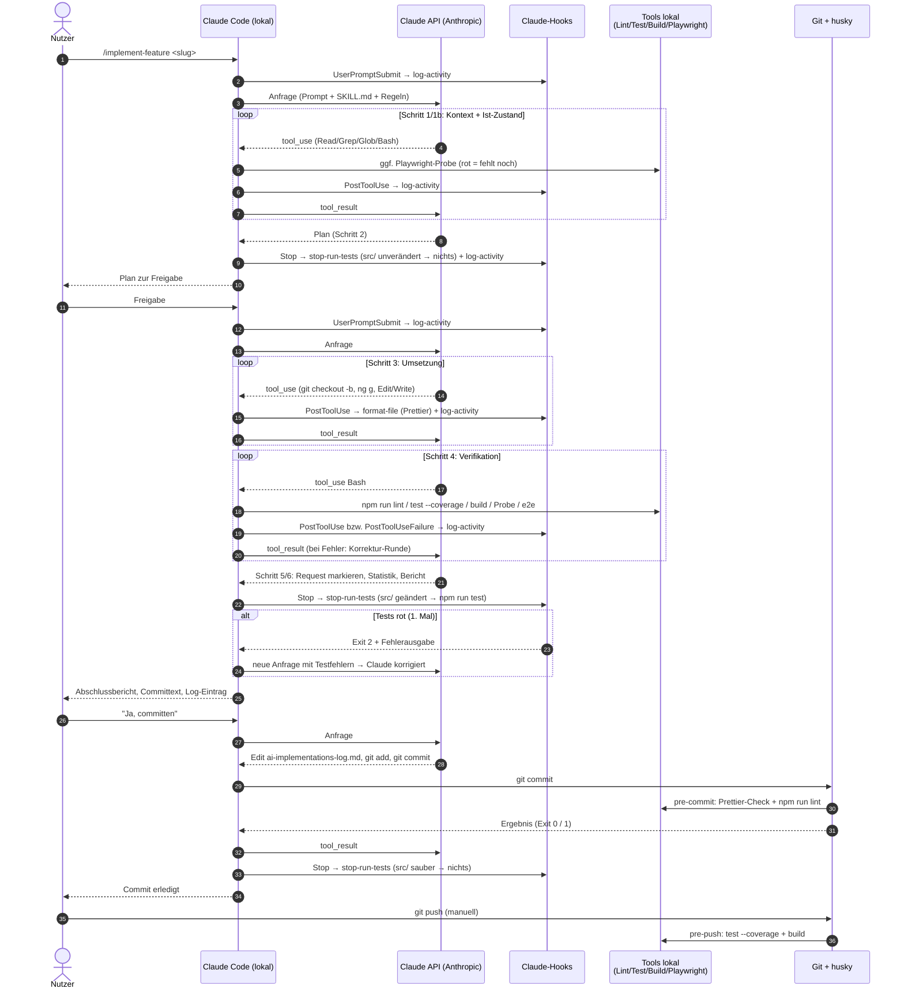
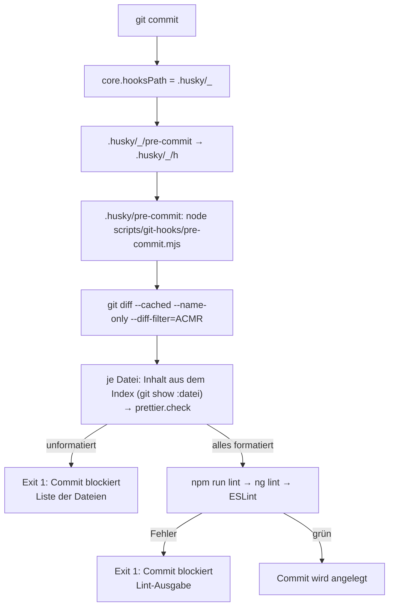
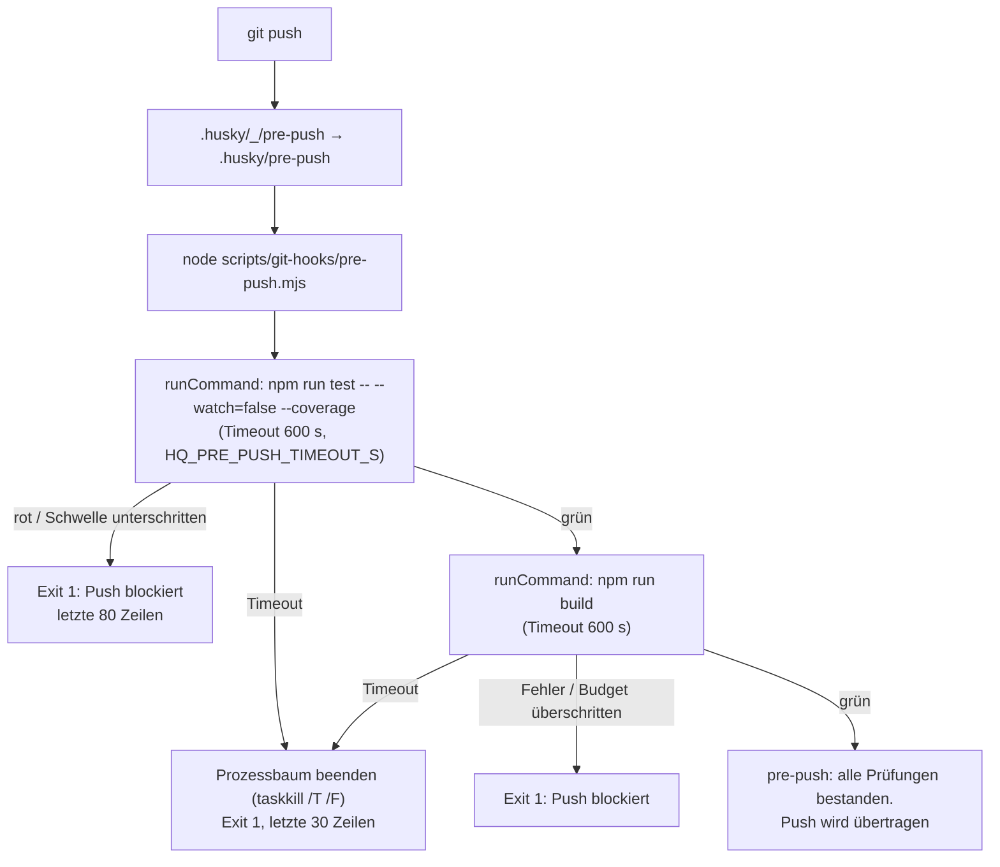

# Ablauf des Skills `implement-feature` – inkl. Commit und Push

Stand: 2026-10-31

Diese Notiz beschreibt Schritt für Schritt, was passiert, wenn `/implement-feature <slug> [#punkt]`
in Claude Code ausgeführt wird, und was beim anschließenden `git commit` und `git push` läuft.
Für jede Phase ist angegeben,

- **wann mit der Claude API kommuniziert wird** (Anfrage an Anthropic),
- **welche Hook-Skripte starten** (Claude-Code-Hooks und Git-Hooks),
- **wann Linter, Tests, Build und Playwright laufen**.

Quellen: `.claude/skills/implement-feature/SKILL.md`, `.claude/settings.json`, `.claude/hooks/*.mjs`,
`.husky/*`, `scripts/git-hooks/*.mjs`, `scripts/claude/work-statistics.mjs`. Details zu den
einzelnen Werkzeugen stehen in [CI-CD/README.md](../CI-CD/README.md).

---

## 1. Grundprinzip: Wo läuft was?

| Ort                        | Was läuft dort                                                                                           |
| -------------------------- | -------------------------------------------------------------------------------------------------------- |
| **Anthropic (Claude API)** | Nur das Modell. Es entscheidet, welches Tool als Nächstes aufgerufen wird, und schreibt Text.            |
| **Lokal: Claude Code**     | Führt die Tools aus (Read, Edit, Bash, …), startet die Claude-Code-Hooks, hält das Sitzungsprotokoll.    |
| **Lokal: Git + husky**     | Startet die Git-Hooks `pre-commit` / `pre-push` – unabhängig davon, ob Claude oder ein Mensch committet. |

**Wichtig:**

- **Jede Modell-Runde ist genau eine API-Anfrage.** Claude Code schickt Systemprompt,
  `CLAUDE.md` + Regeln, Tool-Definitionen und den bisherigen Verlauf (inkl. aller Tool-Ergebnisse)
  an die API. Die Antwort enthält Text und/oder Tool-Aufrufe (`tool_use`). Claude Code führt die
  Tools **lokal** aus, startet die Hooks und schickt das Ergebnis (`tool_result`) in der **nächsten**
  API-Anfrage zurück. Das wiederholt sich, bis das Modell ohne Tool-Aufruf antwortet.
- **Kein Hook-Skript spricht selbst mit der API.** Alle Hooks (`format-file.mjs`,
  `log-activity.mjs`, `stop-run-tests.mjs`, `pre-commit.mjs`, `pre-push.mjs`) sind lokale
  Node-Prozesse. Sie beeinflussen die API-Kommunikation nur indirekt: Ihre Ausgabe kann in die
  nächste Anfrage einfließen (z. B. Testfehler aus dem Stop-Hook).
- **Linter, Tests, Build, Playwright laufen immer lokal**, entweder weil Claude sie per `Bash`
  aufruft oder weil ein Hook sie startet.
- Mehrere Tool-Aufrufe in einer Antwort werden lokal nacheinander bzw. parallel ausgeführt und
  gemeinsam in **einer** Folge-Anfrage zurückgemeldet.
- Nebenaufrufe von Claude Code (z. B. automatische Zusammenfassung bei sehr langem Verlauf) sind
  ebenfalls API-Anfragen, gehören aber nicht zum Skill-Ablauf.

### Registrierte Claude-Code-Hooks (`.claude/settings.json`)

| Ereignis                      | Skript               | Wirkung                                                                   | Timeout              |
| ----------------------------- | -------------------- | ------------------------------------------------------------------------- | -------------------- |
| `UserPromptSubmit`            | `log-activity.mjs`   | schreibt `PROMPT …` nach `.claude/logs/activity.log`                      | 5 s                  |
| `PostToolUse` (`Edit\|Write`) | `format-file.mjs`    | formatiert die geänderte Datei mit Prettier (schreibt die Datei neu)      | 30 s                 |
| `PostToolUse` (`*`)           | `log-activity.mjs`   | schreibt `<Tool> <Detail>` ins Aktivitätslog                              | 5 s                  |
| `PostToolUseFailure` (`*`)    | `log-activity.mjs`   | schreibt `FAIL <Tool> <Detail>` (z. B. roter Test, blockierter Commit)    | 5 s                  |
| `Stop`                        | `stop-run-tests.mjs` | Unit-Tests ohne Coverage, **nur wenn `src/` uncommittete Änderungen hat** | 300 s (intern 240 s) |
| `Stop`                        | `log-activity.mjs`   | schreibt `STOP ── Antwort fertig ──`                                      | 5 s                  |

Hooks desselben Ereignisses starten parallel. Ein `PostToolUse`-Hook läuft, **nachdem** das Tool
ausgeführt wurde und **bevor** das Ergebnis per API an das Modell geht – das Modell sieht also
bereits die Prettier-formatierte Datei.

### Registrierte Git-Hooks (husky)

| Git-Ereignis | Datei               | Skript                             | Prüfungen                                                   |
| ------------ | ------------------- | ---------------------------------- | ----------------------------------------------------------- |
| `git commit` | `.husky/pre-commit` | `scripts/git-hooks/pre-commit.mjs` | Prettier-Check auf gestagten Inhalt, **`npm run lint`**     |
| `git push`   | `.husky/pre-push`   | `scripts/git-hooks/pre-push.mjs`   | `npm run test -- --watch=false --coverage`, `npm run build` |

### Berechtigungen, die den Ablauf prägen

- `defaultMode: "plan"` – die Sitzung startet im Plan-Modus (nur lesen, keine Änderungen). Erst die
  Freigabe des Plans (Schritt 2) schaltet in einen Modus mit Schreibrechten.
- `git commit *` ist für Claude erlaubt, **`git push *` ist verboten** (`deny`). Den Push führt
  immer der Mensch aus.
- `npm install *` und `rm -rf *` sind verboten.

---

## 2. Gesamtüberblick

---

## 3. Ablauf im Detail

Legende für die Spalte **API:** ⇄ = eine oder mehrere API-Anfragen (eine pro Modell-Runde),
— = keine API-Kommunikation.

### Phase 0 – Aufruf

| #   | Was passiert                                                                                    | API | Hooks / Skripte                                                                | Lint/Test/Build |
| --- | ----------------------------------------------------------------------------------------------- | --- | ------------------------------------------------------------------------------ | --------------- |
| 0.1 | Nutzer tippt `/implement-feature <slug> [#punkt]`                                               | —   | `UserPromptSubmit` → `log-activity.mjs` schreibt `PROMPT /implement-feature …` | —               |
| 0.2 | Claude Code lädt `SKILL.md` als Anweisung in den Prompt (`$ARGUMENTS` = Slug + Punkt)           | —   | —                                                                              | —               |
| 0.3 | Erste Anfrage: Systemprompt, `CLAUDE.md`, `.claude/rules/*.md`, Memory-Index, Skill-Text, Tools | ⇄   | —                                                                              | —               |

Die `PROMPT`-Zeile ist später der Startpunkt der Arbeitsstatistik (Phase 6).

### Phase 1 – Kontext laden (Skill-Schritt 1)

| #   | Was passiert                                                                               | API | Hooks / Skripte                         | Lint/Test/Build |
| --- | ------------------------------------------------------------------------------------------ | --- | --------------------------------------- | --------------- |
| 1.1 | `Read` `REQUIREMENTS.md`, `docs/feature-requests/<slug>.md`, Regeln (`architecture.md`, …) | ⇄   | je Tool: `PostToolUse` → `log-activity` | —               |
| 1.2 | `Grep`/`Glob`/`Read` auf betroffene Dateien und Aufrufer                                   | ⇄   | je Tool: `log-activity`                 | —               |

Jedes Tool-Ergebnis geht in der nächsten Anfrage zurück an die API. Mehrere unabhängige `Read`s in
einer Antwort ergeben trotzdem nur eine Folge-Anfrage.

### Phase 1b – Ist-Zustand prüfen

| #    | Was passiert                                                                                        | API | Hooks / Skripte                                            | Lint/Test/Build      |
| ---- | --------------------------------------------------------------------------------------------------- | --- | ---------------------------------------------------------- | -------------------- |
| 1b.1 | Code lesen, ggf. vorhandene Specs ausführen (`npm run test -- --watch=false --include <pfad>`)      | ⇄   | `log-activity`; roter Test → `PostToolUseFailure` → `FAIL` | **Vitest** (gezielt) |
| 1b.2 | Bei UI-Verhalten: Probe `e2e/probe/<slug>-<punkt>.spec.ts` schreiben (`Write`)                      | ⇄   | `format-file.mjs` (Prettier) + `log-activity`              | —                    |
| 1b.3 | Probe ausführen: `npx playwright test --project=probe e2e/probe/<datei>` (startet `ng serve :4321`) | ⇄   | `log-activity`; rot → `FAIL`-Zeile                         | **Playwright**       |
| 1b.4 | Ergebnis je Punkt: fehlt noch / bereits umgesetzt / teilweise / nicht prüfbar                       | ⇄   | —                                                          | —                    |

Erwartet ist hier eine **rote** Probe (Soll-Verhalten fehlt noch). Ist ein Punkt bereits erfüllt,
fragt Claude nach (`AskUserQuestion`) – die Antwort des Nutzers ist eine neue Runde mit neuer
API-Anfrage.

### Phase 2 – Plan und Freigabe

| #   | Was passiert                                                                    | API | Hooks / Skripte                                                                                | Lint/Test/Build |
| --- | ------------------------------------------------------------------------------- | --- | ---------------------------------------------------------------------------------------------- | --------------- |
| 2.1 | Modell erstellt den Plan (Reihenfolge, Dateien, Testfälle, Probe, Verifikation) | ⇄   | —                                                                                              | —               |
| 2.2 | Plan wird zur Freigabe vorgelegt (Plan-Modus → `ExitPlanMode`), Antwort endet   | —   | `Stop` → `stop-run-tests.mjs`: `src/` unverändert → **sofort Exit 0**; `log-activity` → `STOP` | —               |
| 2.3 | Nutzer gibt frei                                                                | ⇄   | `UserPromptSubmit` bzw. Tool-Ergebnis → `log-activity`                                         | —               |

Bis hierher wurde nichts geändert; der Stop-Hook startet daher keine Tests.

### Phase 3 – Umsetzung

| #   | Was passiert                                                | API | Hooks / Skripte                                                                                                     | Lint/Test/Build |
| --- | ----------------------------------------------------------- | --- | ------------------------------------------------------------------------------------------------------------------- | --------------- |
| 3.1 | Branch anlegen: `git checkout -b _dev_feature-<slug>`       | ⇄   | `log-activity`                                                                                                      | —               |
| 3.2 | Neue Bausteine per CLI: `ng g c\|s\|m …` (`Bash`)           | ⇄   | `log-activity` (die erzeugten Dateien werden **nicht** von `format-file` erfasst – nur `Edit`/`Write` lösen es aus) | —               |
| 3.3 | Code und Specs ändern (`Edit`/`Write`)                      | ⇄   | je Datei parallel: **`format-file.mjs`** (Prettier) + `log-activity`                                                | —               |
| 3.4 | Fehlgeschlagenes `Edit` (z. B. `old_string` nicht gefunden) | ⇄   | `PostToolUseFailure` → `FAIL Edit …`                                                                                | —               |

Prettier läuft also nach **jeder** einzelnen Datei-Änderung durch Claude, bevor das Modell das
Ergebnis sieht. Dadurch ist der Prettier-Check im `pre-commit` später in der Regel grün.

### Phase 4 – Verifikation (nach jedem Punkt)

Alle Befehle startet Claude selbst per `Bash`. Jeder Befehl = Tool-Ausführung lokal + Ergebnis in
der nächsten API-Anfrage. Schlägt ein Befehl fehl, liest das Modell die Ausgabe, korrigiert
(Phase 3) und wiederholt die Prüfung – jede Korrektur kostet weitere API-Runden.

| #   | Befehl                                                     | API | Hooks / Skripte            | Was wird geprüft                                   |
| --- | ---------------------------------------------------------- | --- | -------------------------- | -------------------------------------------------- |
| 4.1 | `npm run lint` (`ng lint`, ESLint auf `src/**/*.ts\|html`) | ⇄   | `log-activity` bzw. `FAIL` | **1. Linter-Lauf** (durch Claude)                  |
| 4.2 | `npm run test -- --watch=false --coverage`                 | ⇄   | `log-activity` bzw. `FAIL` | Vitest + Coverage-Schwellen aus `vitest.config.ts` |
| 4.3 | Coverage-Report lesen (`Read coverage/…`)                  | ⇄   | `log-activity`             | ungetestete Zeilen/Zweige der geänderten Dateien   |
| 4.4 | `npm run build`                                            | ⇄   | `log-activity` bzw. `FAIL` | Production-Build inkl. Budgets                     |
| 4.5 | Probe erneut: `npx playwright test --project=probe …`      | ⇄   | `log-activity` bzw. `FAIL` | Probe muss jetzt **grün** sein                     |
| 4.6 | `npm run e2e` (Smoke-Suite, nur bei UI-Änderungen)         | ⇄   | `log-activity` bzw. `FAIL` | Regressionen                                       |

Bei mehreren Punkten ohne `#punkt` wiederholen sich Phase 3 und 4 je Punkt. Schlägt die
Verifikation fehl, hält Claude an und meldet den Fehler.

### Phase 5 – Feature Request abschließen

| #   | Was passiert                                                                                              | API | Hooks / Skripte                                         | Lint/Test/Build |
| --- | --------------------------------------------------------------------------------------------------------- | --- | ------------------------------------------------------- | --------------- |
| 5.1 | `Edit` am Request: `✅ done (YYYY-MM-DD HH:MM)`, `**Status:**`, Akzeptanzkriterien `[x]`                  | ⇄   | `format-file.mjs` (Prettier auf `.md`) + `log-activity` | —               |
| 5.2 | Bei vollständig umgesetztem Request: `git mv docs/feature-requests/<slug>.md docs/feature-requests/done/` | ⇄   | `log-activity`                                          | —               |

### Phase 6 – Abschlussbericht, Statistik, Commit-Vorschlag

| #   | Was passiert                                                                                       | API                                  | Hooks / Skripte                                                                                                                                              | Lint/Test/Build         |
| --- | -------------------------------------------------------------------------------------------------- | ------------------------------------ | ------------------------------------------------------------------------------------------------------------------------------------------------------------ | ----------------------- |
| 6.1 | `node scripts/claude/work-statistics.mjs --skill implement-feature`                                | ⇄ (nur das Ergebnis geht an die API) | `log-activity`; das Skript selbst liest **lokal** `activity.log`, das Sitzungsprotokoll `~/.claude/projects/*/<session>.jsonl` und `git diff` – keine API    | —                       |
| 6.2 | Modell schreibt Abschlussbericht, Committext und `ai-implementations-log.md`-Eintrag (nur im Chat) | ⇄                                    | —                                                                                                                                                            | —                       |
| 6.3 | Antwort endet                                                                                      | —                                    | **`Stop` → `stop-run-tests.mjs`**: `src/` hat uncommittete Änderungen → `npm run test -- --watch=false` (ohne Coverage, max. 240 s); `log-activity` → `STOP` | **Vitest** (durch Hook) |

**Verhalten des Stop-Hooks in 6.3:**

- Tests grün → Antwort wird dem Nutzer angezeigt.
- Tests rot oder Timeout (1. Mal) → Exit-Code 2: Claude Code schickt die Fehlerausgabe in einer
  **neuen API-Anfrage** an das Modell, Claude muss nachbessern. Danach läuft der Stop-Hook erneut.
- Beim 2. Versuch (`stop_hook_active`) blockiert der Hook nicht mehr, sondern zeigt nur
  `⚠ Unit-Tests schlagen weiterhin fehl` an.

Der Stop-Hook läuft am Ende **jeder** Antwort, nicht nur am Skill-Ende. Solange `src/` nicht
geändert ist (Phase 0–2) oder bereits committet ist (nach Phase 7), passiert nichts.

---

## 4. Commit (Phase 7 – nach Freigabe durch den Nutzer)

Der Nutzer bestätigt Committext und Log-Eintrag. Ab hier:

| #   | Was passiert                                                          | API | Hooks / Skripte                                                             | Lint/Test/Build                     |
| --- | --------------------------------------------------------------------- | --- | --------------------------------------------------------------------------- | ----------------------------------- |
| 7.1 | Nutzer antwortet „ja“                                                 | ⇄   | `UserPromptSubmit` → `log-activity`                                         | —                                   |
| 7.2 | `Edit ai-implementations-log.md` (Eintrag inkl. `- **Statistik:** …`) | ⇄   | `format-file.mjs` + `log-activity`                                          | —                                   |
| 7.3 | `git add <dateien>`                                                   | ⇄   | `log-activity`                                                              | —                                   |
| 7.4 | `git commit -m "feat(<scope>): …"` (per `Bash`)                       | ⇄   | **Git-Hook `pre-commit`** (siehe unten), danach `log-activity` bzw. `FAIL`  | **Prettier-Check + 2. Linter-Lauf** |
| 7.5 | Antwort endet                                                         | —   | `Stop` → `stop-run-tests.mjs`: `src/` jetzt sauber → nichts; `log-activity` | —                                   |

### Was `git commit` genau auslöst

1. Git ruft den husky-Stub `.husky/_/pre-commit` auf; dieser startet `.husky/pre-commit`.
2. `pre-commit.mjs` ermittelt die gestagten Dateien und prüft deren **Index-Inhalt** mit Prettier
   (nicht die Working Copy, wegen CRLF durch `core.autocrlf`).
3. Danach **`npm run lint`** – das ist der **zweite Linter-Lauf** im Gesamtablauf (der erste war
   Schritt 4.1 durch Claude).
4. Kein Test, kein Build im `pre-commit` (Ziel < ~15 s).

**Keine API-Kommunikation während des Hooks.** Der Hook läuft innerhalb des `Bash`-Tool-Aufrufs
von Claude. Erst wenn `git commit` fertig ist, geht die Ausgabe (inkl. Hook-Meldungen) in der
nächsten API-Anfrage an das Modell. Wird der Commit blockiert, landet ein `FAIL Bash …` im
Aktivitätslog, und Claude korrigiert in weiteren Runden.

Committet der Nutzer selbst (Terminal oder VS Code), läuft derselbe Hook – ohne jede
Claude-Beteiligung.

---

## 5. Push (Phase 8 – immer manuell)

Claude darf nicht pushen (`deny: Bash(git push *)`). Der Nutzer führt `git push` selbst aus,
typischerweise für den Branch `_dev_feature-<slug>` und anschließend Merge nach `development`.

| #   | Was passiert | API | Hooks / Skripte                          | Lint/Test/Build                    |
| --- | ------------ | --- | ---------------------------------------- | ---------------------------------- |
| 8.1 | `git push`   | —   | **Git-Hook `pre-push`** → `pre-push.mjs` | Tests + Coverage, Production-Build |

### Was `git push` genau auslöst

- Coverage-Schwellen: Lines 95 %, Branches 90 %, Functions 85 %, Statements 95 %.
- **Kein Linter im `pre-push`** – Lint ist bereits durch den `pre-commit` abgesichert.
- **Keine Playwright-Tests** im `pre-push`.
- **Keine API-Kommunikation**, keine Claude-Hooks (läuft außerhalb von Claude Code). Auch kein
  `activity.log`-Eintrag.
- Es gibt keine Server-CI; nach dem Push passiert auf GitHub nichts automatisch. Deployment nur
  manuell per `npm run deploy`.

---

## 6. Zusammenfassung: Wann läuft was?

### Linter (`npm run lint` / ESLint)

| Zeitpunkt              | Ausgelöst durch       | Blockiert     |
| ---------------------- | --------------------- | ------------- |
| Phase 4.1 Verifikation | Claude (`Bash`)       | Skill hält an |
| Phase 7.4 `git commit` | Git-Hook `pre-commit` | Commit        |

Nicht im Stop-Hook, nicht im `pre-push`, nicht nach einzelnen Edits.

### Prettier

| Zeitpunkt                            | Ausgelöst durch                               | Modus                        |
| ------------------------------------ | --------------------------------------------- | ---------------------------- |
| nach jedem `Edit`/`Write` von Claude | Claude-Hook `PostToolUse` → `format-file.mjs` | formatiert (schreibt)        |
| `git commit`                         | Git-Hook `pre-commit`                         | nur Check (gestagter Inhalt) |

### Unit-Tests (Vitest)

| Zeitpunkt                                                    | Ausgelöst durch                           | Coverage       |
| ------------------------------------------------------------ | ----------------------------------------- | -------------- |
| Phase 1b (optional, gezielt)                                 | Claude (`Bash`)                           | nein           |
| Phase 4.2                                                    | Claude (`Bash`)                           | ja             |
| Ende jeder Antwort, wenn `src/` geändert und nicht committet | Claude-Hook `Stop` → `stop-run-tests.mjs` | nein           |
| `git push`                                                   | Git-Hook `pre-push`                       | ja (Schwellen) |

### Build

| Zeitpunkt  | Ausgelöst durch     |
| ---------- | ------------------- |
| Phase 4.4  | Claude (`Bash`)     |
| `git push` | Git-Hook `pre-push` |

### Playwright

| Zeitpunkt       | Ausgelöst durch | Was                        |
| --------------- | --------------- | -------------------------- |
| Phase 1b.3      | Claude (`Bash`) | Probe, erwartet rot        |
| Phase 4.5 / 4.6 | Claude (`Bash`) | Probe grün + `npm run e2e` |

### Claude API

| Kommuniziert                                                        | Kommuniziert nicht                                             |
| ------------------------------------------------------------------- | -------------------------------------------------------------- |
| jede Modell-Runde (nach Nutzer-Prompt und nach jedem Tool-Ergebnis) | alle Hook-Skripte selbst                                       |
| nach blockierendem Stop-Hook (Exit 2) mit den Testfehlern           | `work-statistics.mjs` (liest nur lokale Dateien)               |
| nach Antworten auf Rückfragen (`AskUserQuestion`, Plan-Freigabe)    | `git commit` während des Hooks (erst das Ergebnis geht zurück) |
| Subagenten (`Agent`-Tool) – eigene, getrennte Anfrage-Ketten        | `git push` (komplett ohne Claude)                              |

### Aktivitätslog (`.claude/logs/activity.log`)

Bei jedem Ereignis in Claude Code eine Zeile `<Zeit>  <Sitzung>  [sub] <Art> <Detail>`:
`PROMPT` (Nutzer-Prompt), `<Tool>` (erfolgreicher Tool-Aufruf), `FAIL` (fehlgeschlagener
Tool-Aufruf, z. B. roter Test oder blockierter Commit), `STOP` (Antwort fertig). Grundlage für die
Arbeitsstatistik in Phase 6. Der `pre-push` erscheint dort nicht.
